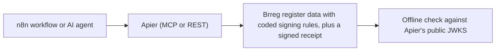

# n8n-nodes-apier: Norwegian company signing authority and register changes in n8n

[](https://github.com/apier-no/n8n-nodes-apier/actions/workflows/ci.yml)
[](./LICENSE)

An [n8n](https://n8n.io) community node for [Apier](https://apier.no). Apier gives AI agents and workflows machine-verifiable Norwegian company authority: for a 9-digit organisasjonsnummer it returns the company's signing authority, signaturrett and prokura, as Brønnøysundregistrene (Brreg) hold it in Enhetsregisteret and Fullmakttjenesten, with the source and date on every answer. With this node a workflow can read who may sign for a Norwegian company (for example daglig leder alone, or two board members jointly) and react when the register changes. Typical uses are KYB steps in onboarding and supplier checks.

## Try it in 30 seconds (no key)

The public sandbox answers for the test company `999999999` without a key or an account:

```bash
curl -s https://www.apier.no/api/v1/sandbox/public/company/999999999/authority
```

Response from 2026-11-25, trimmed (other fields omitted):

```json
{
  "success": true,
  "data": {
    "org_number": "999999999",
    "name": "Apier Public Sandbox AS",
    "entity_type": "AS",
    "classification": "sole",
    "summary": "Én rolle kan signere alene for selskapet.",
    "combinations": [
      {
        "kombinasjons_id": "SANDBOX-KOMB-DAGL-ALENE",
        "description": "Daglig leder signerer alene.",
        "role_codes": ["DAGL"]
      }
    ],
    "signaturrett_holders": [{ "role": "DAGL", "name": "Ola Nordmann" }],
    "prokura_holders": [],
    "source": "brreg.fullmakt",
    "rule_set": "no.brreg.signatur.v1"
  },
  "_meta": { "is_sandbox": true, "source": "apier.no" }
}
```

In n8n you can make the same call with the built-in **HTTP Request** node: method `GET`, that URL, no authentication. Sandbox data is fictional. The public sandbox allows 100 requests per hour per IP address.

The Apier nodes in this package call production and need an API key. They do not call the sandbox.

## How it fits together



The nodes in this package return the register data. Signed receipts are requested over the REST API with `?certificate=true`; see https://www.apier.no/docs/guides/verify-certificate.

## Nodes

**Apier**

| Resource | Operation | API call |
|---|---|---|
| Company | Get Authority: the coded signing rules and prokura, as the Brønnøysund Registers hold them | `GET /api/v1/company/{org}/authority` |
| Company | Get Summary: obligations and upcoming deadlines | `GET /api/v1/company/{org}/summary` |
| Change | Get Many: detected register changes, newest first | `GET /api/v1/changes` |
| Subscription | Create, Get Many, Delete: send matching changes to a webhook | `/api/v1/subscriptions` |

Every company answer keeps Apier's `_meta` block (rulebook version, data freshness, source), so a later step can show where the answer came from.

**Apier Trigger** polls `GET /api/v1/changes` and starts the workflow for each new change from one source, optionally for one organisation or one entity type (for example `annual_accounts` for new annual accounts filings). When it is first turned on it starts from that moment and does not replay older changes. Each poll re-reads the last five minutes, so a change that is saved late is still delivered, and a change it has already delivered is not delivered again. A poll reads at most 5,000 changes; if more than that can arrive between two polls, filter by organisation or entity type.

Without an organisation number, changes to board members, signing rules and prokura are withheld by the API. Set an organisation number to receive them.

Sources: Brønnøysund Registers, Norges Bank, NAV Aa-registeret and Skatteetaten. Altinn and DigDir sources are not offered: their data is not licensed for commercial reuse.

## Install

The package is not on npm yet, so it cannot be installed from the n8n community nodes screen today.

Once it is published: in n8n, go to **Settings > Community Nodes**, select **Install**, and enter `n8n-nodes-apier`.

Until then, on a self-hosted n8n, build a tarball from this repository and install it by hand:

```bash
git clone https://github.com/apier-no/n8n-nodes-apier.git
cd n8n-nodes-apier
npm install --legacy-peer-deps
npm run build
npm pack
```

Then install the resulting `n8n-nodes-apier-0.1.0.tgz` in the `~/.n8n/nodes` directory of your n8n instance with `npm i <path to the tarball>` and restart n8n. n8n documents this directory under [manual installation](https://docs.n8n.io/integrations/community-nodes/installation/manual-install/).

## Credentials

Create an API key at <https://www.apier.no/sign-up> and add it as an **Apier API** credential. The key is sent in the `Authorization: Bearer` header only. Company lookups need the `read:brreg` scope, the change history needs `read:changes` (the default `read:*` key covers both), and subscriptions need `subscribe:webhooks`.

Calls made with a key are charged per call; see the [pricing page](https://www.apier.no/pricing).

## Example workflow: re-read signing authority when the register changes

1. Add an **Apier Trigger** node. Set **Source** to `brreg` and **Organisation Number** to the company you want to watch.
2. Add an **Apier** node after it. Set **Resource** to `Company`, **Operation** to `Get Authority`, and **Organisation Number** to the same number.
3. Add the node that should receive the result, for example **Send Email** or **Slack**. The Apier node's output item holds the fields of the API's `data` object, with `_meta` beside them.

When Brreg registers a change for that company, the trigger starts the workflow, the Apier node reads the current signing rules, and the last node passes them on.

To try the Apier node on its own, connect a **Manual Trigger** to it and run the workflow once.

## When not to use Apier

- Apier returns the register's own coding of signing rules, uninterpreted. It gives no yes or no on whether a person may sign for a given action. Your workflow applies the rules.
- It is not AML, PEP or sanctions screening.
- It is not legal advice.
- Sandbox data is fictional. A sandbox answer says nothing about a real company.

## Development

```bash
npm install
npm run typecheck
npm test
npm run build
```

No lockfile is committed yet; the devDependencies are pinned to exact versions.

## Links

- Apier: https://apier.no
- Docs: https://www.apier.no/docs
- MCP docs: https://www.apier.no/docs/mcp
- Pricing: https://www.apier.no/pricing
- Examples in curl, TypeScript, Python and Go: https://github.com/apier-no/apier-quickstart

## License

MIT. See [LICENSE](./LICENSE).
